# Desktop Widgets

Desktop widgets for GNOME Shell: clock, calendar, weather, music, photos, battery, and more. Widgets are placed directly on your desktop background, snapped to a grid, and moved around freely in edit mode.

A fork of [Widgets](https://github.com/TheRealSourcer/widgets) by TheRealSourcer.

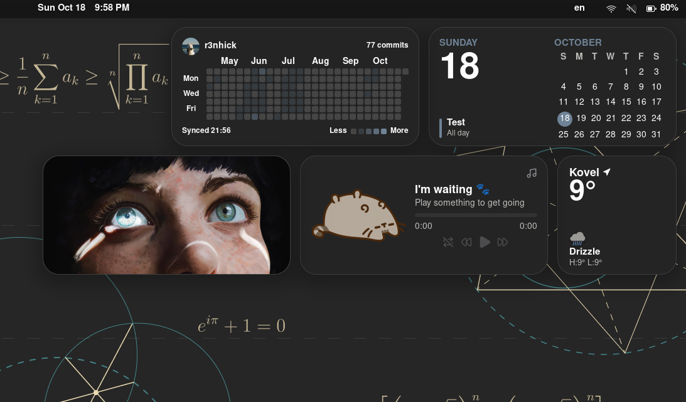

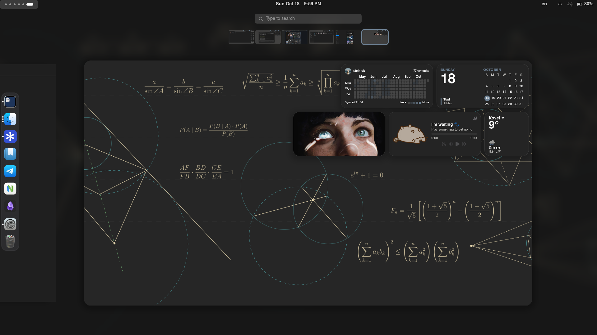

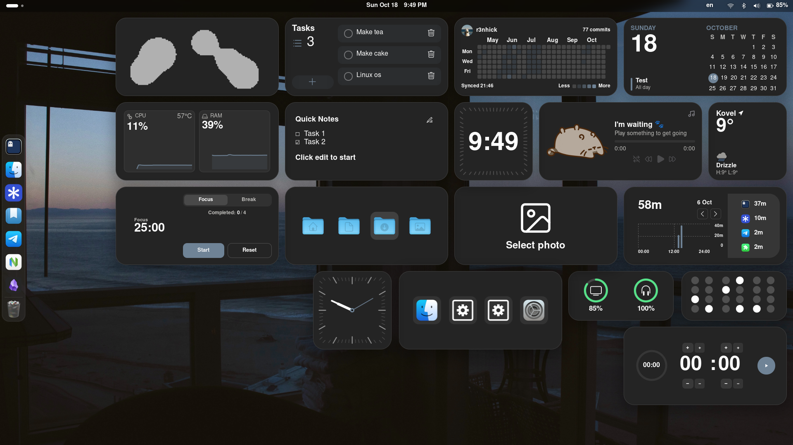

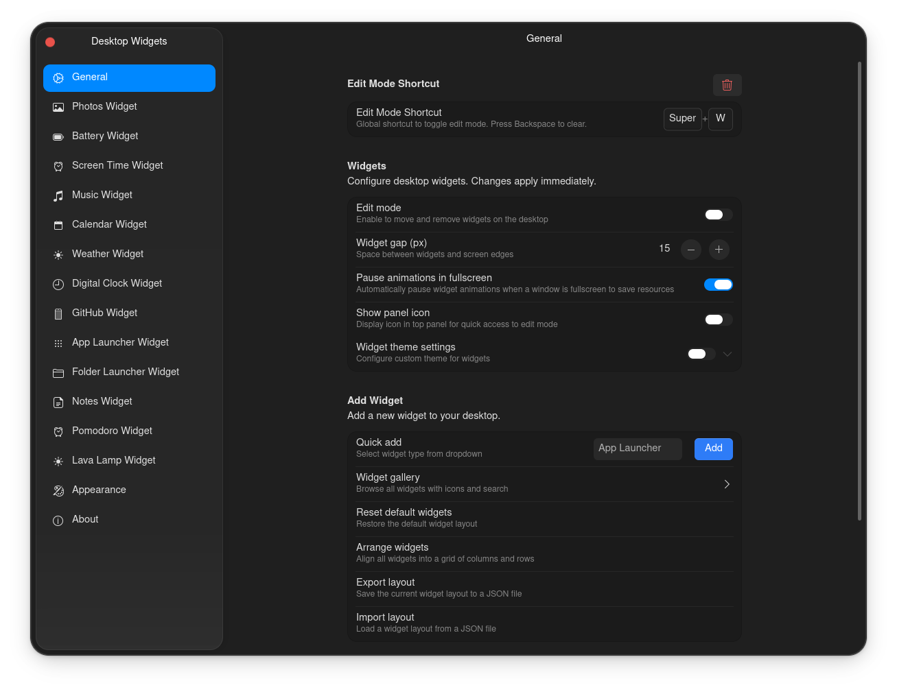

## ✨ Features

- **Grid layout** — widgets snap to a desktop grid and can be freely arranged in edit mode
- **Multiple sizes** — mini (2×1), small (1×1), medium (2×1), portrait (1×2), large (2×2), tall (2×4), wide (4×2), huge (4×4)
- **Edit mode** — add, move, resize, and remove widgets with visual feedback; bind a global shortcut to toggle it
- **Custom styling** — border radius, border width and color, background color, box shadow, and global opacity
- **Live updates** — most settings apply immediately without restarting GNOME Shell
- **Translations** — Ukrainian and Russian support

## 🚀 Installation

### From source

```bash
# Clone repository
git clone https://github.com/r3nhick/desktop-widgets.git
cd desktop-widgets

# Install to extensions directory
mkdir -p ~/.local/share/gnome-shell/extensions
cp -r . ~/.local/share/gnome-shell/extensions/desktop-widgets@r3nhick
```

**Important:** Log out of your session and log back in to load the extension.

Then enable it:

```bash
gnome-extensions enable desktop-widgets@r3nhick
```

Or use the Extensions app (GNOME Extensions or Extension Manager).

### First steps

1. **Open Extension Settings**
   - Extensions app → Desktop Widgets → Settings icon
   - Or: `gnome-extensions prefs desktop-widgets@r3nhick`

2. **Add Your First Widget**
   - Click "Add Widget" button
   - Choose a widget type (e.g., "Clock")
   - Click "Add" — the widget appears on your desktop

3. **Position Widgets**
   - Press `Super+W` to enter Edit Mode
   - Drag widgets to desired positions
   - Press `Super+W` again to exit
   - Or click "Arrange widgets" to auto-snap to grid

4. **Configure Widget**
   - Find the widget in settings list
   - Click the settings icon next to it
   - Adjust settings (apply immediately)

### Updating

```bash
cd ~/.local/share/gnome-shell/extensions/desktop-widgets@r3nhick
git pull
```

Then log out of your session and log back in.

## 📦 Available Widgets (19)

<table>
<tr>
<td width="120" align="center"><br/><sub><b>Analog Clock</b></sub></td>
<td width="120" align="center">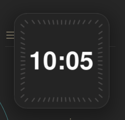<br/><sub><b>Digital Clock</b></sub></td>
<td width="120" align="center"><br/><sub><b>Binary Clock</b></sub></td>
<td width="120" align="center">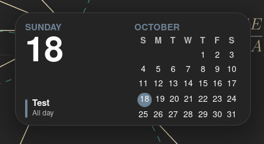<br/><sub><b>Calendar</b></sub></td>
<td width="120" align="center"><br/><sub><b>Timer</b></sub></td>
</tr>
<tr>
<td align="center"><br/><sub><b>Stopwatch</b></sub></td>
<td align="center">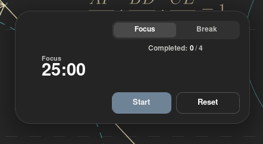<br/><sub><b>Pomodoro</b></sub></td>
<td align="center"><br/><sub><b>Tasks</b></sub></td>
<td align="center"><br/><sub><b>Notes</b></sub></td>
<td align="center">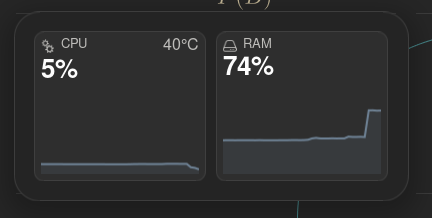<br/><sub><b>System Monitor</b></sub></td>
</tr>
<tr>
<td align="center"><br/><sub><b>Battery</b></sub></td>
<td align="center">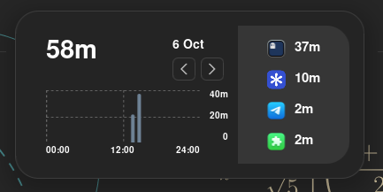<br/><sub><b>Screen Time</b></sub></td>
<td align="center"><br/><sub><b>Music</b></sub></td>
<td align="center"><br/><sub><b>Photos</b></sub></td>
<td align="center"><br/><sub><b>Lava Lamp</b></sub></td>
</tr>
<tr>
<td align="center">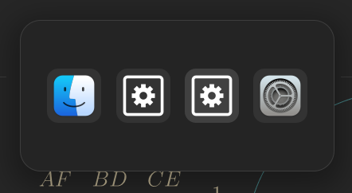<br/><sub><b>App Launcher</b></sub></td>
<td align="center">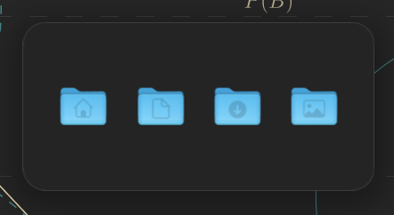<br/><sub><b>Folder Launcher</b></sub></td>
<td align="center">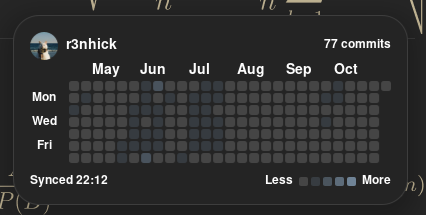<br/><sub><b>GitHub</b></sub></td>
<td align="center"><br/><sub><b>Weather</b></sub></td>
<td></td>
</tr>
</table>

[📖 See detailed widget descriptions](#-widget-gallery--details)

## 📋 Requirements

- **GNOME Shell** 45+ (tested on 45, 46, 47)
- **For Weather widget:** GNOME Weather app installed
- **For Music widget:** Any MPRIS-compatible media player
- **For GitHub widget:** Internet connection (caches data for offline use)

## 📖 Documentation

<details>
<summary><strong>🎯 Widget Gallery & Details</strong> — Detailed description of all 19 widgets</summary>

### ⏰ Time & Productivity Widgets

<details>
<summary><strong>Analog Clock</strong> — Classic analog clock</summary>

**Sizes:** Small, Medium, Large, Portrait

Classic analog clock with hour, minute, and second hands.

**Features:**
- Smooth animations for second hand
- Customizable colors
- Multiple size options
- Clean, minimal design

**Settings:**
- Show/hide second hand
- Clock face colors
- Hand colors and width

</details>

<details>
<summary><strong>Digital Clock</strong> — Digital time and date</summary>

**Sizes:** Small, Medium, Large

Digital time and date display with clean typography.

**Features:**
- 12/24 hour format support
- Date display with localization
- Configurable seconds display
- Large, readable font

**Settings:**
- Time format (12/24 hour)
- Show/hide seconds
- Date format
- Text colors

</details>

<details>
<summary><strong>Binary Clock</strong> — Time in binary format</summary>

**Sizes:** Small, Medium, Large

Time displayed in binary format — perfect for developers and geeks.

**Features:**
- Binary representation of hours, minutes, seconds
- Color-coded rows (hours/minutes/seconds)
- Educational and unique
- Real-time updates

**Settings:**
- Color scheme
- Show/hide labels

</details>

<details>
<summary><strong>Calendar</strong> — Monthly calendar view</summary>

**Sizes:** Small, Medium, Portrait, Large

Monthly calendar with current day highlight and week numbers.

**Features:**
- Current month view
- Today highlighted in accent color
- Week numbers displayed
- Previous/next month navigation
- Localized day and month names

**Settings:**
- First day of week (Monday/Sunday)
- Show/hide week numbers
- Accent color

</details>

<details>
<summary><strong>Timer</strong> — Countdown timer</summary>

**Sizes:** Medium

Countdown timer with visual progress indicator and notifications.

**Features:**
- Adjust time with +/- buttons (±1 and ±10 minutes/seconds)
- Two modes: setup (adjust) and running (countdown)
- Circular progress indicator
- Pause and reset controls
- Desktop notification when finished
- Sound alert (optional)

**Settings:**
- Default time
- Notification settings
- Sound alert on/off

</details>

<details>
<summary><strong>Stopwatch</strong> — Elapsed time counter</summary>

**Sizes:** Medium, Large

Elapsed time counter with start/pause/reset controls.

**Features:**
- Counts time upward from zero
- Large, easy-to-read display
- Start, pause, resume, reset buttons
- Shows hours, minutes, seconds, milliseconds
- Lap time support (in large size)

**Settings:**
- Display format
- Colors

</details>

<details>
<summary><strong>Pomodoro Timer</strong> — Focus timer with breaks</summary>

**Sizes:** Small, Medium

Pomodoro technique timer with automatic work/break cycles.

**Features:**
- 25 min work / 5 min short break / 15 min long break (default)
- Automatic cycling through sessions
- Visual progress indicator
- Notifications for phase changes
- Session counter
- Pause/resume support

**Settings:**
- Work duration (default 25 min)
- Short break duration (default 5 min)
- Long break duration (default 15 min)
- Sessions before long break (default 4)
- Notification settings

</details>

<details>
<summary><strong>Tasks (Todo List)</strong> — Simple task manager</summary>

**Sizes:** Medium, Portrait, Large, Tall

Simple and effective todo list with checkboxes.

**Features:**
- Add/remove tasks quickly
- Check off completed items
- Persistent storage across sessions
- Larger sizes for more tasks
- Strike-through for completed tasks
- Task reordering

**Settings:**
- Font size
- Completed task behavior (hide/show)
- Colors

</details>

<details>
<summary><strong>Notes</strong> — Quick text notes</summary>

**Sizes:** Medium, Portrait, Large, Tall

Quick text notes widget for jotting down ideas.

**Features:**
- Plain text editing
- Auto-saves as you type
- Persistent storage
- Scrollable for longer notes
- Markdown-like formatting (optional)

**Settings:**
- Font size and family
- Text color
- Auto-save delay

</details>

### 💻 System & Monitoring Widgets

<details>
<summary><strong>System Monitor</strong> — Resource monitoring</summary>

**Sizes:** Small, Medium, Large

Real-time system resource monitoring with sparkline graphs.

**Features:**
- **CPU usage** — per-core or total percentage
- **GPU usage** — if supported by system
- **RAM usage** — used/total memory with percentage
- **Disk usage** — used/total space
- **Network** — download/upload speeds in real-time
- Swipe left/right or click to switch metrics
- Historical sparkline graphs
- Color-coded indicators (green/yellow/red)
- Updates every 5 seconds

**Settings:**
- Metrics to display
- Update interval
- Warning thresholds
- Graph colors

</details>

<details>
<summary><strong>Battery</strong> — Battery level indicators</summary>

**Sizes:** Small, Medium, Large

Battery charge rings for your computer and Bluetooth devices.

**Features:**
- Main battery level with ring indicator
- Connected Bluetooth device batteries (mouse, keyboard, headphones, etc.)
- Charging status indicator with animation
- Time remaining estimate
- Multiple device support (up to 4 devices in large size)
- Low battery warnings

**Settings:**
- Show/hide device names
- Low battery threshold
- Ring colors

</details>

<details>
<summary><strong>Screen Time</strong> — Usage tracking</summary>

**Sizes:** Medium, Large

Daily application usage tracking and statistics.

**Features:**
- Tracks time spent in each application
- Shows most-used apps today
- Pie chart visualization (in large size)
- Historical data (last 7 days)
- Privacy-focused (local storage only, no telemetry)
- Exclude apps from tracking

**Settings:**
- Reset time (daily at midnight)
- Apps to exclude
- Number of apps to show

</details>

### 🎵 Media & Content Widgets

<details>
<summary><strong>Music Player</strong> — Now playing display</summary>

**Sizes:** Medium, Portrait, Large

Now playing display with playback controls via MPRIS.

**Features:**
- Album artwork display
- Track title, artist, and album
- Play/pause and skip controls (if supported by player)
- Progress bar (if supported)
- Works with: GNOME Music, Rhythmbox, Spotify, VLC, Amberol, and most Linux media players
- Auto-hides when nothing is playing
- Multiple player support

**Settings:**
- Preferred player (if multiple are running)
- Show/hide controls
- Album art size

</details>

<details>
<summary><strong>Photos</strong> — Photo slideshow</summary>

**Sizes:** All sizes supported

Display rotating photos from selected folders or a single custom photo.

**Features:**
- Add multiple photo folders
- Auto-rotation through images
- Or set a single static photo
- Configurable rotation interval (5 sec - 10 min)
- Supports JPG, PNG, WebP, GIF
- Scales to fit any widget size
- Random or sequential order

**Settings:**
- Photo folders (add/remove)
- Rotation interval
- Playback mode (random/sequential)
- Zoom mode (fit/fill/stretch)

</details>

<details>
<summary><strong>Lava Lamp</strong> — Animated decoration</summary>

**Sizes:** Medium, Large

Animated decorative lava lamp effect for aesthetic desktops.

**Features:**
- Smooth blob animations using Clutter
- Customizable blob and background colors
- Multiple blobs with physics simulation
- Relaxing visual effect
- Low CPU usage

**Settings:**
- Number of blobs (2-8)
- Blob colors
- Background color
- Animation speed

</details>

### 🚀 Launcher & Integration Widgets

<details>
<summary><strong>App Launcher</strong> — Application shortcuts</summary>

**Sizes:** Medium, Large, Wide

Quick access grid for your favorite applications.

**Features:**
- Pin up to 16 applications
- Drag and drop from applications menu to add apps
- Reorder by dragging within widget
- Remove apps by dragging out
- Real application icons from system
- Single-click to launch
- Adaptive grid layout (2×2, 3×3, 4×4 depending on size)
- Badge indicators for running apps (optional)

**Settings:**
- Icon size
- Show app names
- Grid layout
- Badge indicators

</details>

<details>
<summary><strong>Folder Launcher</strong> — Folder shortcuts</summary>

**Sizes:** Medium, Large

Quick access to frequently used folders.

**Features:**
- Add multiple folders (up to 8)
- Opens in your preferred file manager
- Real folder icons from filesystem
- Optional folder name labels
- Auto-detects file manager (Nautilus, Dolphin, Thunar, Nemo, Caja, PCManFM)
- Custom file manager command support

**Settings:**
- Folders to display (add/remove with file picker)
- Show folder names
- File manager preference
- Icon size

</details>

<details>
<summary><strong>GitHub Activity</strong> — Profile statistics</summary>

**Sizes:** Large, Wide

Display your GitHub profile statistics and contribution graph.

**Features:**
- Profile picture and bio
- Repository count (public/private if token provided)
- Follower/following count
- Contribution graph for the past year (365 days)
- Commit activity heatmap
- Streak counter (current/longest)
- Caches data for offline viewing
- Updates every hour

**Settings:**
- GitHub username
- Personal access token (optional, for private repos)
- Update interval
- Color scheme

</details>

<details>
<summary><strong>Weather</strong> — Current conditions</summary>

**Sizes:** All sizes supported

Current weather conditions and temperature using GNOME Weather data.

**Features:**
- Uses GNOME Weather location settings
- Current temperature
- Weather condition icon
- Feels-like temperature
- High/low for today
- Humidity and wind speed (in larger sizes)
- Forecast for next hours/days (in large sizes)
- Auto-updates every 30 minutes

**Requirements:**
- GNOME Weather app must be installed
- Location set in GNOME Weather settings

**Settings:**
- Temperature units (°C/°F)
- Update interval
- Forecast length

</details>

</details>

<details>
<summary><strong>⚙️ Advanced Configuration</strong> — Detailed settings and customization</summary>

## Global Settings

### Grid Configuration

- **Grid Cell Width** — Width of one grid cell in pixels (default: 120)
- **Grid Cell Height** — Height of one grid cell in pixels (default: 120)
- **Grid Spacing** — Gap between widgets in pixels (default: 16)

### Edit Mode

- **Keyboard Shortcut** — Key combination to toggle Edit Mode (default: Super+W)
- **Show Grid Lines** — Display grid overlay in Edit Mode (default: on)
- **Snap Strength** — How strongly widgets snap to grid (default: medium)

### Theme & Styling

#### Global Opacity
- **Opacity** — Transparency of all widgets (0-100%, default: 100%)
- Affects all widgets unless overridden per-widget

#### Default Widget Style
These apply to new widgets (existing widgets keep their settings):

- **Border Radius** — Rounded corners (0-32px, default: 16px)
- **Border Width** — Thickness of border (0-8px, default: 1px)
- **Border Color** — RGBA color with transparency
- **Background Color** — RGBA color with transparency
- **Box Shadow** — Drop shadow effect
  - Horizontal offset (-20 to 20px)
  - Vertical offset (-20 to 20px)
  - Blur radius (0-40px)
  - Shadow color (RGBA)

### Per-Widget Settings

Each widget in the list has:

#### Basic Settings
- **Widget Type** — Shows widget type (cannot be changed)
- **Size** — Dropdown to change widget size (if multiple sizes supported)
- **Position** — X/Y coordinates (or drag in Edit Mode)

#### Style Override
- **Use Custom Style** — Toggle to override global theme for this widget
- When enabled, shows same style options as global settings
- Allows each widget to have unique appearance

#### Widget-Specific Settings
Each widget type has its own settings. Click the settings icon to access them.

### Example: Clock Widget Settings
- **Time Format** — 12-hour or 24-hour
- **Show Seconds** — Display seconds hand
- **Clock Face Color** — Background color of clock face
- **Hour Hand Color** — Color of hour hand
- **Minute Hand Color** — Color of minute hand
- **Second Hand Color** — Color of second hand

### Example: Weather Widget Settings
- **Temperature Units** — Celsius or Fahrenheit
- **Update Interval** — How often to fetch new data (15-120 min)
- **Show Forecast** — Display forecast for upcoming hours/days

### Example: System Monitor Settings
- **Metrics** — Which metrics to display (CPU, RAM, GPU, Disk, Network)
- **Update Interval** — Refresh rate (1-10 seconds)
- **CPU Warning Threshold** — When to show yellow (default: 60%)
- **CPU Critical Threshold** — When to show red (default: 85%)
- **Show History Graph** — Display sparkline

### Data Management

Some widgets store data:

#### App Launcher
- Pinned apps stored in: `~/.local/share/desktop-widgets@r3nhick/applauncher-{id}.json`

#### Tasks (Todo)
- Task list stored in: `~/.local/share/desktop-widgets@r3nhick/todo-{id}.json`

#### Notes
- Note content in: `~/.local/share/desktop-widgets@r3nhick/notes-{id}.json`

#### Screen Time
- Usage history in: `~/.local/share/desktop-widgets@r3nhick/screentime-{id}.json`

#### GitHub
- Cached profile data in: `~/.local/share/desktop-widgets@r3nhick/github-{id}.json`

To reset a widget's data, delete its JSON file and restart GNOME Shell.

</details>

<details>
<summary><strong>🔄 Update & Uninstall</strong> — Maintenance guide</summary>

## Updating

To update to a newer version:

```bash
cd ~/.local/share/gnome-shell/extensions/desktop-widgets@r3nhick
git pull
```

Then log out and log back in (or restart GNOME Shell with `Alt+F2` → `r` on X11).

### If Git Pull Fails

If you see "error: Your local changes..." it means files were modified locally.

**Option 1:** Discard local changes and update to latest
```bash
git reset --hard origin/main
git clean -fd
```
**Warning:** This deletes any modifications you made to the code.

**Option 2:** Keep your changes and merge
```bash
git stash
git pull
git stash pop
```
Then resolve any conflicts manually.

### Checking Your Version

```bash
cd ~/.local/share/gnome-shell/extensions/desktop-widgets@r3nhick
git log -1 --oneline
```

## Uninstalling

### Remove Extension Only

```bash
rm -rf ~/.local/share/gnome-shell/extensions/desktop-widgets@r3nhick
```

Then log out and log back in. Your widget data is preserved.

### Complete Removal (Extension + Data)

Remove extension, all widget data, and settings:

```bash
# Remove extension
rm -rf ~/.local/share/gnome-shell/extensions/desktop-widgets@r3nhick

# Remove widget data (pinned apps, tasks, notes, etc.)
rm -rf ~/.local/share/desktop-widgets@r3nhick

# Reset all settings
gsettings reset-recursively org.gnome.shell.extensions.desktop-widgets-r3nhick
```

Then log out and log back in.

</details>

<details>
<summary><strong>🛠️ Development & Contributing</strong> — For developers</summary>

## Project Structure

```
desktop-widgets@r3nhick/
├── extension.js              # Main extension, widget controller
├── prefs.js                 # Settings UI (GTK4)
├── metadata.json            # Extension metadata
├── stylesheet.css           # Global styles
├── widgets/                 # Widget modules
│   ├── clock/
│   │   └── widget.js       # Clock widget implementation
│   ├── calendar/
│   │   └── widget.js
│   └── .../
├── utils/                   # Shared utilities
│   ├── ported.js           # Utility functions
│   └── gnomeCompat.js      # GNOME version compatibility
├── schemas/                 # GSettings schemas
│   └── org.gnome.shell.extensions.desktop-widgets-r3nhick.gschema.xml
├── locale/                  # Translations
│   ├── uk/
│   │   └── LC_MESSAGES/
│   │       └── desktop-widgets@r3nhick.mo
│   └── ru/
├── icons/                   # Widget icons
│   └── widgets/
│       ├── clock.svg
│       └── .../
└── README.md
```

## Adding a New Widget

### 1. Create Widget Module

Create `widgets/yourwidget/widget.js`:

```javascript
import St from 'gi://St';
import Clutter from 'gi://Clutter';
import { gettext as _ } from 'resource:///org/gnome/shell/extensions/extension.js';

// Required exports
export const type = 'yourwidget';
export const label = 'Your Widget';
export const defaultSize = 'medium';
export const supportedSizes = ['small', 'medium', 'large'];

// Optional: if you need custom stylesheet
export const stylesheet = 'widgets/yourwidget/stylesheet.css';

// Optional: if clicking should open an app
export const appIds = ['org.gnome.YourApp'];

// Style for widget container (border, background, etc.)
export function style(theme) {
  return `
    .yourwidget-container {
      /* CSS for the widget */
    }
  `;
}

// Main render function
export function render({body, theme, widget, settings, sizeForWidget}) {
  // body is a St.BoxLayout container
  // Clear any previous content
  body.remove_all_children();
  
  // Build your widget UI
  const label = new St.Label({
    text: 'Hello from Your Widget!',
    style_class: 'yourwidget-label',
  });
  
  body.add_child(label);
  
  // Return cleanup function (optional)
  return () => {
    // Clean up timers, connections, etc.
  };
}
```

### 2. Register in extension.js

Add import and register in `WIDGET_MODULES`:

```javascript
import * as YourWidget from './widgets/yourwidget/widget.js';

const WIDGET_MODULES = [
  ClockWidget,
  CalendarWidget,
  // ... other widgets
  YourWidget,  // Add here
];
```

### 3. Add to Preferences

Edit `prefs.js` to add your widget to the list:

```javascript
const WIDGET_TYPES = [
  {type: 'clock'},
  {type: 'calendar'},
  // ... other types
  {type: 'yourwidget'},  // Add here
];

const widgetTypeLabel = (type) => ({
  clock: _('Clock'),
  calendar: _('Calendar'),
  // ... other labels
  yourwidget: _('Your Widget'),  // Add here
}[type] ?? type);

const DEFAULT_SIZES = {
  clock: 'small',
  calendar: 'medium',
  // ... other defaults
  yourwidget: 'medium',  // Add here
};
```

### 4. Add Widget Icon

Create `icons/widgets/yourwidget.svg` (64×64px recommended).

### 5. Test

```bash
# Recompile schemas if you added settings
glib-compile-schemas schemas/

# Reload extension (X11 only: Alt+F2 → r)
# Or log out and back in

# Enable widget
gnome-extensions enable desktop-widgets@r3nhick
```

Open settings and add your new widget!

## Widget Development Tips

### Using Settings

If your widget needs settings, add them to `schemas/*.gschema.xml`:

```xml
<key name="yourwidget-some-setting" type="s">
  <default>''</default>
  <summary>Some Setting</summary>
</key>
```

Access in widget:

```javascript
export function render({body, theme, widget, settings}) {
  const value = settings.get_string('yourwidget-some-setting');
  // Use the value...
}
```

### Timers and Updates

For widgets that update periodically:

```javascript
export function render({body, theme, widget, settings}) {
  // ... build UI
  
  let timerId = null;
  
  function update() {
    // Update widget content
  }
  
  // Set up timer
  timerId = GLib.timeout_add(GLib.PRIORITY_DEFAULT, 1000, () => {
    update();
    return GLib.SOURCE_CONTINUE;
  });
  
  // Return cleanup function
  return () => {
    if (timerId) {
      GLib.Source.remove(timerId);
      timerId = null;
    }
  };
}
```

### Responsive Sizing

Use `sizeForWidget()` to get current size:

```javascript
export function render({body, sizeForWidget, widget}) {
  const {width, height} = sizeForWidget(widget.size);
  
  if (width < 200) {
    // Small layout
  } else {
    // Large layout
  }
}
```

### Data Persistence

Use the utility functions:

```javascript
import { saveJsonToFileAsync, loadJsonFromFileAsync, getDataDir } from '../../utils/ported.js';

// Save
const data = {key: 'value'};
const filename = `yourwidget-${widget.id}.json`;
await saveJsonToFileAsync(getDataDir(), filename, data);

// Load
const loaded = await loadJsonFromFileAsync(getDataDir(), filename);
```

## Building for Release

Compile translations and schemas:

```bash
# Compile schemas
glib-compile-schemas schemas/

# Update translations
node tools/extract-strings.mjs
```

Pack extension:

```bash
gnome-extensions pack \
  --schema=org.gnome.shell.extensions.desktop-widgets-r3nhick \
  --extra-source=widgets/ \
  --extra-source=icons/ \
  --extra-source=utils/ \
  --extra-source=prefs/ \
  --extra-source=layouts/ \
  --extra-source=locale/ \
  --extra-source=paths.js \
  --extra-source=logger.js \
  --extra-source=workspaceIntegration.js \
  --extra-source=layoutDoc.js \
  --extra-source=utils.js \
  .
```

## Contributing

We welcome contributions!

### Bug Reports
- Use [GitHub Issues](https://github.com/r3nhick/desktop-widgets/issues)
- Include GNOME Shell version
- Attach logs: `journalctl -f -o cat /usr/bin/gnome-shell`
- Describe steps to reproduce

### Pull Requests
- Fork the repository
- Create a feature branch: `git checkout -b feature-name`
- Follow existing code style
- Test on GNOME Shell before submitting
- Update README if adding features
- Commit with clear messages

### Translations
- Decompile `.mo` file: `msgunfmt -o /tmp/lang.po locale/lang/LC_MESSAGES/desktop-widgets@r3nhick.mo`
- Edit `.po` file with Poedit or text editor
- Compile back: `msgfmt /tmp/lang.po -o locale/lang/LC_MESSAGES/desktop-widgets@r3nhick.mo`
- Submit PR with updated `.mo` file

### Code Style
- Use ES6+ features
- 2-space indentation
- `const` for constants, `let` for variables (avoid `var`)
- Clear variable names
- Add comments for complex logic

</details>

## 📋 Requirements

- **GNOME Shell** 45+ (tested on 45, 46, 47)
- **For Weather widget:** GNOME Weather app installed
- **For Music widget:** Any MPRIS-compatible media player
- **For GitHub widget:** Internet connection (caches data for offline use)

## 🤝 Contributing

Contributions welcome! See [Development & Contributing](#-development--contributing) section above.

- 🐛 Report bugs via [GitHub Issues](https://github.com/r3nhick/desktop-widgets/issues)
- 💡 Request features
- 🔧 Submit pull requests
- 🌍 Add translations
- 📸 Share your desktop setup

## 📄 License

GNU General Public License v3.0 — see [LICENSE](LICENSE) for details.

## 🙏 Credits

- Original [Widgets extension](https://github.com/TheRealSourcer/widgets) by TheRealSourcer
- Maintained and extended by [r3nhick](https://github.com/r3nhick)
- Community contributors

---

**Made with ❤️ for the GNOME community**

**[⬆ Back to top](#desktop-widgets)**
