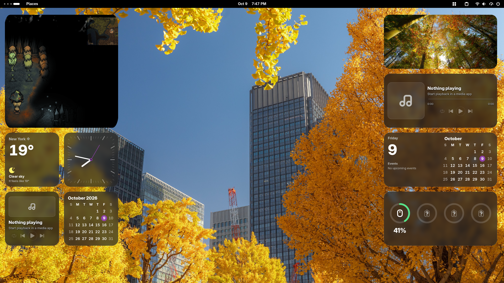

**This GitHub repo (<https://github.com/TheRealSourcer/widgets>) is the official
source for the project. Do not download releases from unverified sources.**

# Widgets (V0.3.0)


This is a GNOME Shell extension that provides gnome-themed widgets to your desktop.



It focuses on:

 - **integration**: easy access in GNOME top panel and incorporation with the GNOME ecosystem.
 - **style**: tightly follows GNOME Shell theme and styling.
 - **freedom**: free software licensed under the GNU General Public License v3.0

Its features include:

- **Analog Clock**: a traditional clock face that updates in real time.
- **Calendar**: a monthly calendar with muted weekend days; Wide adds the date and upcoming events beside the month grid.
- **Weather**: current conditions and, in larger sizes, the upcoming daily forecast using your GNOME Weather location.
- **Photos**: a cover-style photo widget that displays pictures from your Camera, Screenshots, and Downloads folders.
- **Battery**: battery levels for the computer and connected Bluetooth devices, with support for up to four devices.
- **Digital Clock**: a scalable digital time display.
- **Binary Clock**: a binary-coded clock that updates every second.
- **Media Player**: MPRIS playback information and media controls for music and video.
- **Tasks**: a persistent interactive task list.
- **GitHub Activity**: a contribution graph for a selected public GitHub profile.
- **App Launcher**: a desktop grid for launching installed applications.
- **Screen Time**: local per-application focused-window usage statistics.
- **Events**: upcoming events from GNOME Calendar and Evolution Data Server.
- **Stocks**: market quotes and recent trends for configurable symbols.

Widgets are available in Small (square), Wide (two small widgets across), and
Large (four small widgets arranged 2*2) sizes. Open the searchable, categorized widget gallery
with **Super+W** or the top-panel launcher. Choose a size, then click its preview
to add the widget to the desktop. Drag a gallery preview to place its selected
size directly on the desktop or an overview workspace preview, or drag a size
button to place that size. Use the gallery and **Edit** to move or remove
desktop widgets and **Done** to finish.

Open extension settings from the gallery or its top-panel launcher's right-click
menu. Preferences include the gallery shortcut and launcher, digital clock
format, GitHub username and colors, media-player options, stock symbols, Screen
Time retention, configurable corner rounding, and translucent background blur.
The Media Player can also hide GNOME Shell's built-in MPRIS cards.

Interface translations are included for German, Spanish, French, Japanese,
Brazilian Portuguese, Russian, Ukrainian, and Simplified Chinese. Some strings
fall back to English.

## Prerequisites

1. **GNOME Shell:** Versions 45 through 51.
2. **Weather widget:** GNOME Weather and the GWeather typelib must be installed.
3. **Events widget:** GNOME Calendar and Evolution Data Server's ECal and
   EDataServer typelibs are needed to display calendar events.

## Get the extension

 - **GNOME Extensions Website:** [Download from extensions.gnome.org] *https://extensions.gnome.org/extension/10607/widgets/*
 - **Manual Installation:**
   ```bash
    mkdir -p ~/.local/share/gnome-shell/extensions
    git clone https://github.com/TheRealSourcer/widgets.git \
      ~/.local/share/gnome-shell/extensions/widgets@distro.com
   ```
    *Log out and back in to load the code, then enable Widgets via the "Extensions" app.*

## Resources

 - [GNOME Extensions Guide](https://gjs.guide/extensions/) - For GNOME extension environments.

## Contact

You can open an [issue] for bug reports, feature requests, or general questions regarding the GNOME extension.

[issue]: https://github.com/TheRealSourcer/widgets/issues

## Credits

The Digital Clock, Binary Clock, Music, Tasks, GitHub Activity, App Launcher,
and Screen Time widgets were adapted from contributions by
[r3nhick](https://github.com/r3nhick/desktop-widgets).

## License

This project is licensed under the [GNU General Public License v3.0](LICENSE).
